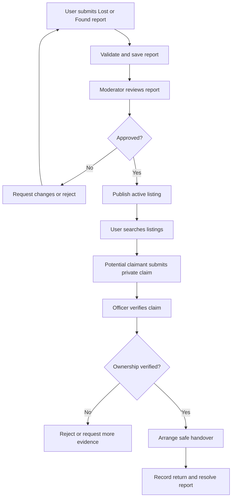

# Product Requirements Document (PRD)
## UniLostFound — Design and Development of a Web-Based University Lost and Found Management System

**Version:** 1.0  
**Status:** Proposed  
**Date:** 9 October 2026

## 1. Purpose
UniLostFound is a web-based system that helps university students and staff report, search for, and recover lost or found belongings. It provides a central platform for listing items, submitting claims, verifying ownership, communicating status updates, and allowing administrators to moderate reports.

## 2. Problem Statement
University members may lose items such as student ID cards, wallets, keys, books, bags, phones, or electronic accessories around classrooms, libraries, laboratories, cafeterias, and other campus areas. Reports are often shared through informal social media posts, group chats, notice boards, or word of mouth. These methods make it difficult to search old reports, verify ownership, track item status, and prevent false claims.

## 3. Product Vision
Create a secure, easy-to-use university portal where users can report lost or found items, search existing reports, submit ownership claims, and follow the recovery process.

## 4. Objectives
- Centralize lost and found reports in one searchable portal.
- Make it easier to match lost-item reports with found-item reports.
- Protect items from fraudulent ownership claims.
- Track an item's status from report submission to return.
- Help university staff moderate reports and coordinate handovers.
- Protect personal information and avoid publishing sensitive item details.

## 5. Stakeholders

| Stakeholder | Main need |
|---|---|
| Student | Report lost/found items and search listings |
| Faculty/staff | Report items and assist with recovery |
| Lost & Found officer | Review reports, verify claims, and record handovers |
| Administrator | Manage users, moderate content, and view reports |
| University | Improve campus service, trust, and accountability |

## 6. Scope

### In scope
- Public landing page and searchable item listings
- Account registration and login
- Student/staff and administrator roles
- Lost-item and found-item report submission
- Item categories, date, location, description, and optional image
- Search and filters
- Report moderation and status management
- Ownership claim submission
- Private claim review and verification
- Handover/return confirmation
- In-app notifications
- Basic dashboards and statistics
- Report history and audit records for important actions

### Out of scope for the initial release
- Publicly displaying private contact details
- Payments or rewards
- Facial recognition or automated identity verification
- Native mobile applications
- Live GPS tracking
- External courier delivery
- AI-based image matching (possible future enhancement)

## 7. User Roles

| Role | Permissions |
|---|---|
| Student / Staff | Create lost/found reports, search listings, submit claims, view own reports and claim status |
| Lost & Found Officer / Moderator | Review reports, request edits, approve/reject listings, review claims, record handovers |
| Administrator | Manage accounts and roles, configure categories, review audit logs and system-wide reports |

All protected permissions must be enforced on the backend, not only by hiding frontend buttons.

## 8. Main User Journeys

### A. Reporting a lost item
1. User signs in.
2. User selects **Report Lost Item**.
3. User enters item name, category, approximate date, last-seen location, description, and optional image.
4. System validates the form and saves the report as pending or published according to moderation settings.
5. User receives a reference number and can track report status.

### B. Reporting a found item
1. User signs in and selects **Report Found Item**.
2. User enters item details, found date/location, and a safe description.
3. Sensitive identifying details are kept private for ownership verification.
4. Moderator reviews the listing if moderation is enabled.
5. The listing becomes searchable after approval.

### C. Claiming an item
1. User opens a found-item listing and chooses **Claim Item**.
2. User provides a private explanation and evidence that may establish ownership.
3. The officer reviews the claim and may ask follow-up questions.
4. The claim is approved or rejected with a recorded reason.
5. For an approved claim, the officer coordinates a safe handover and records the return.

## 9. Functional Requirements

| ID | Requirement | Priority |
|---|---|---|
| PR-01 | Users can register and sign in securely. | Must |
| PR-02 | The system enforces user roles and permissions. | Must |
| PR-03 | Users can submit lost-item reports. | Must |
| PR-04 | Users can submit found-item reports. | Must |
| PR-05 | Users can search and filter active listings. | Must |
| PR-06 | Listings include category, description, date, and campus location. | Must |
| PR-07 | Users can view and manage their own reports. | Must |
| PR-08 | Users can submit private claims for found items. | Must |
| PR-09 | Officers can review and decide claims. | Must |
| PR-10 | Officers can moderate listings and update statuses. | Must |
| PR-11 | The system prevents unauthorized users from editing others' reports. | Must |
| PR-12 | Users receive in-app status notifications. | Should |
| PR-13 | Officers can record successful item handovers. | Must |
| PR-14 | Users can upload an optional item image safely. | Should |
| PR-15 | Administrators can manage users and categories. | Should |
| PR-16 | Dashboards show report, claim, and recovery statistics. | Should |
| PR-17 | Important status changes and admin actions are logged. | Should |

## 10. Non-Functional Requirements
- **Usability:** Responsive, clear interface for desktop and mobile.
- **Security:** Password hashing, server-side authorization, input validation, and secure uploads.
- **Privacy:** Hide sensitive item details and personal contact information from public listings.
- **Reliability:** Status and claim changes must be saved consistently.
- **Performance:** Search and listing pages should be responsive for expected university usage.
- **Maintainability:** Separate frontend, API, and database logic.
- **Accessibility:** Labelled forms, keyboard-accessible controls, and readable contrast.
- **Auditability:** Important moderation, claim, and handover actions should be traceable.

## 11. Business Rules
1. A report must have a valid report type: Lost or Found.
2. Only active, approved listings are visible in public search results.
3. Users can edit or withdraw their own reports, subject to status and moderation rules.
4. Users cannot approve their own claims.
5. Claims and ownership evidence must remain private to authorized reviewers.
6. An item cannot be marked returned without an authorized handover confirmation.
7. A report marked Returned/Resolved should no longer appear as an active item.
8. Public listings must not expose passwords, private claim evidence, or unnecessary contact details.
9. Suspected duplicate, misleading, or inappropriate reports may be held for moderation.
10. Important status changes must record the actor and timestamp.

## 12. Success Measures
- A user can submit and track a lost or found report.
- Users can search and filter active listings.
- A claimant can submit private ownership information.
- An officer can approve/reject a claim and record a handover.
- Users cannot modify another user's report.
- Private claim evidence is not available to ordinary users.
- Core workflows pass documented functional and security tests.

## 13. Risks and Mitigations

| Risk | Mitigation |
|---|---|
| False ownership claims | Private verification questions and officer approval |
| Exposure of sensitive details | Hide unique item identifiers and contact information |
| Spam or inappropriate listings | Moderation queue, reporting, and rate limits |
| Duplicate reports | Search before submission and moderator review |
| Unauthorized status changes | Backend role checks and audit logs |
| Personal data misuse | Data minimization and clear retention rules |

## 14. Release Plan

| Release | Deliverables |
|---|---|
| MVP | Accounts, roles, lost/found reports, search, moderation, claims |
| Release 2 | Notifications, image upload, handover confirmation, dashboards |
| Release 3 | Duplicate-report assistance, analytics, improved matching and accessibility |

## 15. Acceptance Criteria
The MVP is acceptable when signed-in users can create and manage lost/found reports, search approved listings, and submit claims. Authorized officers must be able to moderate reports, review claims, and record item handovers. Ownership evidence and protected operations must remain private and role-restricted.

## 16. Main Workflow Diagram

## 17. Conclusion
UniLostFound aims to make the university lost-and-found process more organized, searchable, private, and accountable. The initial release focuses on reports, search, moderation, claims, and verified handovers, with notifications and analytics added in later releases.
