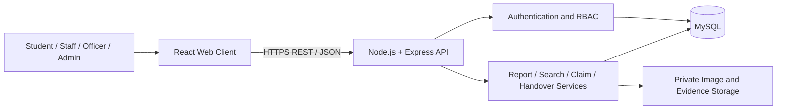
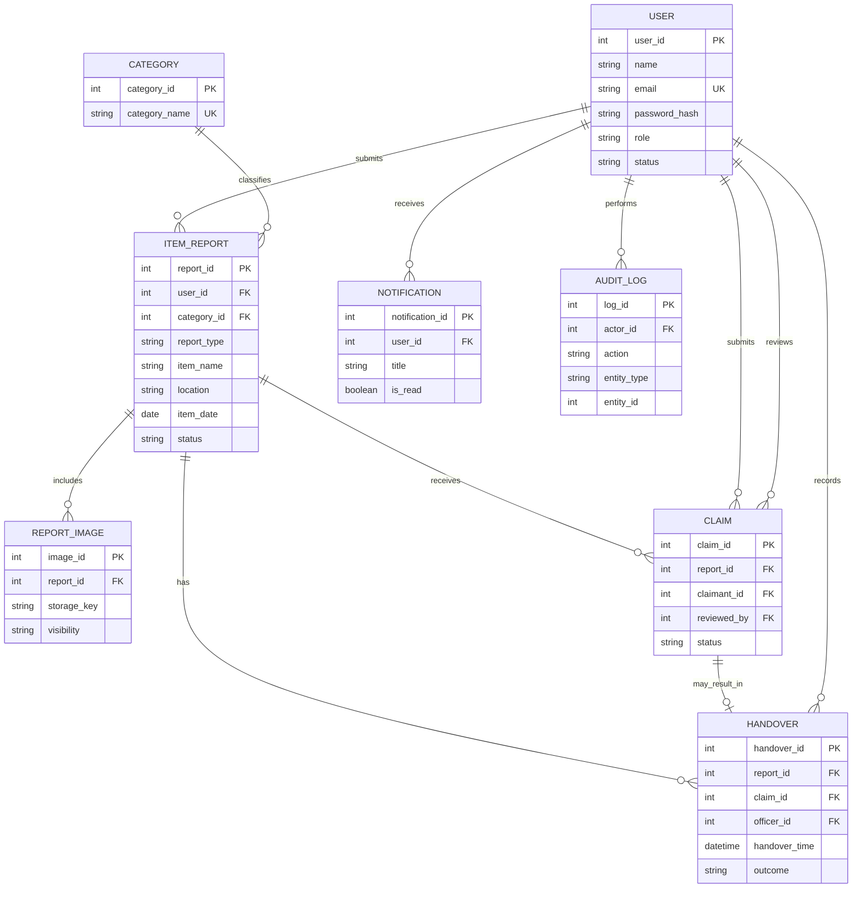
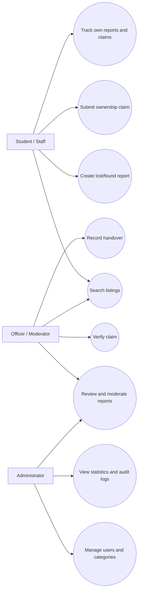
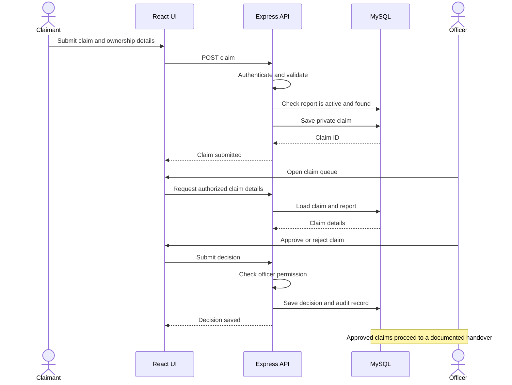

# Software Requirements Specification (SRS)
## UniLostFound — Web-Based University Lost and Found Management System

**Version:** 1.0  
**Status:** Proposed  
**Date:** 9 October 2026

## 1. Introduction

### 1.1 Purpose
This document defines testable functional and non-functional requirements for UniLostFound. It is intended for the project team, supervisor, and testers.

### 1.2 Scope
The system enables university students and staff to report lost or found belongings, search approved listings, submit ownership claims, and track recovery. Moderators and administrators manage report review, claim decisions, handovers, and platform oversight.

### 1.3 Definitions

| Term | Definition |
|---|---|
| Lost report | A report describing an item the user believes they have lost |
| Found report | A report describing an item discovered by a user |
| Claim | A private request to recover a found item |
| Moderator / Officer | Authorized staff member who reviews reports and claims |
| Handover | The documented return of an item to a verified claimant |
| RBAC | Role-Based Access Control |

## 2. Overall Description

### 2.1 Product Architecture

### 2.2 User Classes

| User | Expected use |
|---|---|
| Student / Staff | Report items, search listings, submit claims, track status |
| Officer / Moderator | Review reports and claims, coordinate handovers |
| Administrator | Manage users, categories, permissions, and reports |

### 2.3 Operating Environment
- Current desktop and mobile web browsers.
- React.js frontend.
- Node.js and Express.js backend.
- MySQL relational database.
- Git/GitHub, VS Code, and Postman for development and testing.

### 2.4 Constraints
- Protected actions must be authorized on the backend.
- Passwords must be hashed and never stored as plaintext.
- Private claim evidence must not be exposed in public listings.
- File uploads must be type/size checked and stored safely.
- Database relationships and status transitions must be validated.
- The initial release does not require AI image matching or external messaging services.

## 3. Functional Requirements

### 3.1 Account and Access
- **SRS-FR-001:** Users can register using required account details.
- **SRS-FR-002:** Users can sign in with valid credentials.
- **SRS-FR-003:** Passwords are stored as secure hashes.
- **SRS-FR-004:** Signed-in users can sign out.
- **SRS-FR-005:** The system checks user role and account status for protected operations.
- **SRS-FR-006:** Users can view and update permitted profile fields.

### 3.2 Lost and Found Reports
- **SRS-FR-007:** Signed-in users can create a Lost report.
- **SRS-FR-008:** Signed-in users can create a Found report.
- **SRS-FR-009:** A report includes item name, category, description, approximate date, campus location, and report type.
- **SRS-FR-010:** Users may attach an optional item image.
- **SRS-FR-011:** Users can view their own reports and status.
- **SRS-FR-012:** Users can edit or withdraw their own reports according to policy.
- **SRS-FR-013:** The system assigns each report a unique identifier.
- **SRS-FR-014:** Report status and important status timestamps are stored.

### 3.3 Search and Listing
- **SRS-FR-015:** Users can browse active, approved listings.
- **SRS-FR-016:** Users can search by keywords.
- **SRS-FR-017:** Users can filter by Lost/Found type, category, date, and location.
- **SRS-FR-018:** Public listing results do not expose private claim evidence or unnecessary personal contact details.
- **SRS-FR-019:** Resolved, withdrawn, rejected, or hidden reports are excluded from active search.

### 3.4 Moderation
- **SRS-FR-020:** Authorized officers can view pending reports.
- **SRS-FR-021:** Officers can approve, reject, hide, or request edits to reports.
- **SRS-FR-022:** Only authorized roles can change moderation status.
- **SRS-FR-023:** Moderation decisions record reviewer and timestamp.
- **SRS-FR-024:** Administrators can manage item categories and account roles.

### 3.5 Claims and Verification
- **SRS-FR-025:** A signed-in user can submit a claim for an active Found listing.
- **SRS-FR-026:** A claim includes a private explanation and optional evidence fields.
- **SRS-FR-027:** Claim evidence is visible only to authorized officers and permitted parties.
- **SRS-FR-028:** Officers can request more information, approve, or reject a claim.
- **SRS-FR-029:** A claim decision records the reviewer, timestamp, status, and optional reason.
- **SRS-FR-030:** Users can view the status of their own claims.
- **SRS-FR-031:** The system prevents unauthorized users from viewing or editing another user's claim.

### 3.6 Handover and Notifications
- **SRS-FR-032:** An authorized officer can record an item handover after verification.
- **SRS-FR-033:** Handover records include the item/report, claimant, officer, date/time, and outcome.
- **SRS-FR-034:** A successfully returned item is marked Resolved/Returned and removed from active listings.
- **SRS-FR-035:** The system creates in-app notifications for important report and claim status changes.
- **SRS-FR-036:** Users can view and mark their notifications as read.

### 3.7 Administration and Reporting
- **SRS-FR-037:** Administrators can activate/deactivate accounts and assign permitted roles.
- **SRS-FR-038:** Administrators can view counts of reports, pending claims, and resolved items.
- **SRS-FR-039:** Important administrative and moderation actions are logged.
- **SRS-FR-040:** Authorized users can view reports relevant to their role.

## 4. External Interfaces

### User Interface
The application should provide a landing page, sign-up/sign-in pages, item search/listing page, item detail page, lost/found submission forms, user dashboard, claim form/status page, officer moderation dashboard, handover page, and administrator dashboard.

### Software Interfaces

| Interface | Purpose |
|---|---|
| React ↔ Express API | Request/response communication |
| Express ↔ MySQL | Store and retrieve application data |
| Backend ↔ file storage | Store public-safe images and private evidence |
| Notification service ↔ database | Save and retrieve in-app notifications |

Use HTTPS in deployment, JSON for API payloads, server-side validation, and safe upload handling.

## 5. Data Requirements

| Entity | Important fields |
|---|---|
| User | user_id, name, email, password_hash, role, status |
| Category | category_id, category_name |
| ItemReport | report_id, user_id, category_id, report_type, item_name, description, location, item_date, status |
| ReportImage | image_id, report_id, storage_key, visibility |
| Claim | claim_id, report_id, claimant_id, explanation, evidence, status, reviewed_by |
| Handover | handover_id, report_id, claim_id, officer_id, handover_time, outcome |
| Notification | notification_id, user_id, title, message, is_read |
| AuditLog | log_id, actor_id, action, entity_type, entity_id, created_at |

### Conceptual ER Diagram

## 6. Non-Functional Requirements
- **NFR-001 Security:** Validate authentication, role, and resource ownership on protected endpoints.
- **NFR-002 Privacy:** Restrict claims, evidence, and personal data to authorized users.
- **NFR-003 Performance:** Search and report listing should be responsive for expected university usage.
- **NFR-004 Reliability:** Status changes and handover records must persist consistently.
- **NFR-005 Usability:** Forms should provide clear instructions and validation messages.
- **NFR-006 Compatibility:** Support common current desktop and mobile browsers.
- **NFR-007 Maintainability:** Use modular code, documented APIs, and database migrations/schema files.
- **NFR-008 Accessibility:** Use semantic elements, labels, keyboard navigation, and readable contrast.
- **NFR-009 Auditability:** Important status and administrative changes should be traceable.
- **NFR-010 File safety:** Restrict image/evidence type and size, and prevent executable uploads.

## 7. Use Case Diagram

## 8. Claim and Handover Sequence Diagram

## 9. Business Rules
1. Only approved active listings appear in general search.
2. Only signed-in users can create reports or claims.
3. Users can manage only their own reports unless granted additional permissions.
4. Only authorized officers can review claims and record handovers.
5. Claim evidence must not be publicly accessible.
6. A claim is not proof of ownership by itself; officers use the university's agreed verification procedure.
7. A returned item is marked resolved and removed from active search.
8. Sensitive identifying details (e.g., serial numbers or distinctive contents) should be withheld from public descriptions where needed.
9. Important decisions record the acting user and timestamp.
10. The system must prevent unauthorized status transitions.

## 10. Error Handling
Provide clear messages for invalid credentials, missing report fields, unsupported uploads, unavailable listings, duplicate or invalid claims, unauthorized access, rejected claims, and server/database failures. Do not expose stack traces, password hashes, or private evidence in error responses.

## 11. Testing and Traceability

| Area | Verification |
|---|---|
| Authentication | Valid/invalid login and protected route tests |
| Authorization | User cannot edit another user's report or read private claim evidence |
| Reports | Lost/found submission, edit, withdrawal, moderation |
| Search | Keyword and filter combinations; resolved reports excluded |
| Claims | Submit claim, private evidence access, approve/reject |
| Handover | Authorized handover updates status and creates audit record |
| Uploads | Invalid type/oversized file rejected |
| Notifications | Status changes create notifications for correct users |

## 12. Acceptance Criteria
The MVP is acceptable when users can submit lost/found reports, search approved listings, submit private claims, and track statuses. Authorized officers must be able to moderate listings, review claims, and record handovers. Access-control, privacy, and status-transition tests must pass.

## 13. Conclusion
This SRS establishes a testable baseline for UniLostFound. It can be refined with supervisor feedback while maintaining clear privacy, verification, and accountability requirements.
