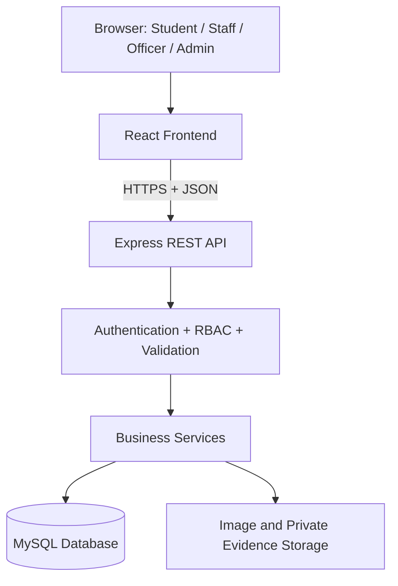
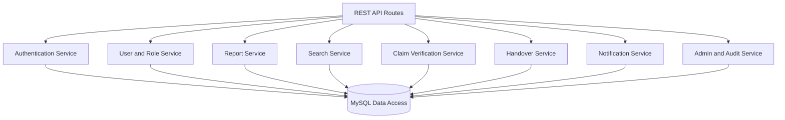
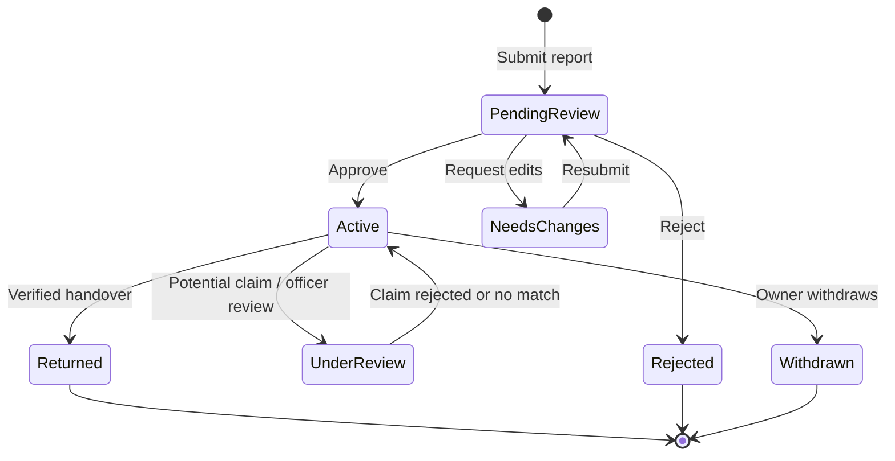
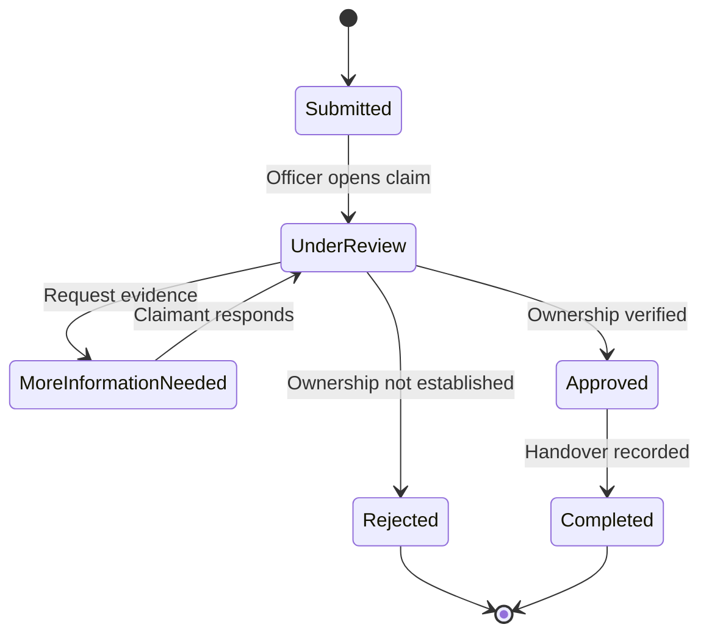
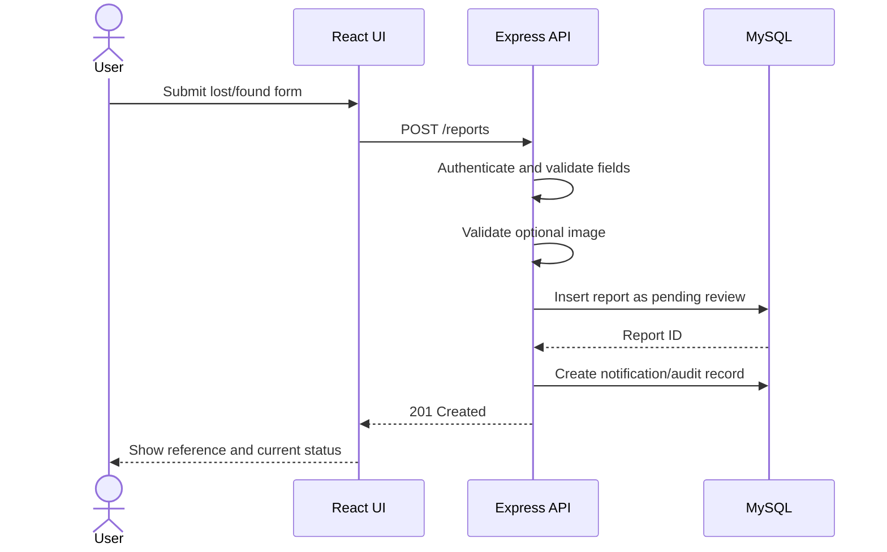

# Technical Design Document (TDD)
## UniLostFound — Web-Based University Lost and Found Management System

**Version:** 1.0  
**Status:** Proposed technical design  
**Date:** 9 October 2026

## 1. Purpose and Design Goals
This document describes the proposed software architecture, modules, database design, API endpoints, security controls, and implementation sequence for UniLostFound.

Goals:
- Separate frontend, backend, and database responsibilities.
- Enforce authentication, role checks, and record ownership on the server.
- Keep claim evidence private.
- Track report and claim status changes reliably.
- Prevent unauthorized handovers and preserve an audit trail.
- Deliver a manageable MVP that can be extended later.

## 2. Technology Stack

| Layer | Technology | Responsibility |
|---|---|---|
| Frontend | React.js | Forms, listings, dashboards |
| Styling | Tailwind CSS or CSS modules | Responsive user interface |
| Routing | React Router | Page navigation |
| API client | Axios or fetch | HTTP requests |
| Backend | Node.js + Express.js | REST API and business logic |
| Database | MySQL | Persistent relational data |
| Authentication | JWT or secure cookie-based sessions | User authentication |
| Password hashing | bcrypt | Secure password storage |
| Upload handling | Multer or equivalent validation middleware | Receive and validate images |
| Testing | Postman and automated tests | API/workflow testing |
| Version control | Git/GitHub | Source control and collaboration |

Choose one authentication approach for the implementation and configure it consistently.

## 3. High-Level Architecture



### Responsibilities
- **Frontend:** Render forms, listings, dashboards, and status messages.
- **API:** Validate requests, authenticate users, authorize actions, and return consistent responses.
- **Services:** Enforce report lifecycle, claim review, privacy, and handover rules.
- **Database:** Store users, reports, claims, status changes, notifications, and audit records.
- **File storage:** Store validated item images and private evidence with access controls.

## 4. Component Design



Recommended backend layers:
1. **Routes:** Map HTTP methods and paths to controllers.
2. **Middleware:** Authentication, role checks, ownership checks, validation, and error handling.
3. **Controllers:** Convert HTTP requests into service calls.
4. **Services:** Enforce business rules and database transaction boundaries.
5. **Repositories/data access:** Use parameterized SQL queries.
6. **Utilities:** File validation, status helpers, notification creation, and audit logging.

## 5. Suggested Folder Structure

```text
university-lost-found/
├── frontend/
│   └── src/
│       ├── components/
│       ├── pages/
│       ├── layouts/
│       ├── routes/
│       ├── services/
│       ├── context/
│       ├── hooks/
│       └── assets/
├── backend/
│   └── src/
│       ├── config/
│       ├── routes/
│       ├── controllers/
│       ├── services/
│       ├── repositories/
│       ├── middleware/
│       ├── validators/
│       └── utils/
├── database/
│   ├── schema.sql
│   └── seed.sql
├── docs/
│   ├── PRD.md
│   ├── SRS.md
│   └── TDD.md
├── .env.example
├── .gitignore
└── README.md
```

## 6. Database Design

| Table | Purpose |
|---|---|
| users | Account, profile, role, and account status |
| categories | Item categories such as ID card, keys, books, bag, electronics |
| item_reports | Lost/found item details and lifecycle status |
| report_images | Image metadata and storage reference |
| claims | Claimant explanation, private evidence, and review outcome |
| handovers | Verified return records |
| notifications | In-app updates |
| audit_logs | Important moderation and administrative actions |

### Data constraints and indexes
- Unique `users.email`.
- Foreign keys for report owner, category, claim, and handover relationships.
- Index `item_reports.status`, `report_type`, `category_id`, `item_date`, and `location` as appropriate.
- Index claims by `report_id`, `claimant_id`, and `status`.
- Validate allowed report and claim status values.
- Store file storage keys rather than trusting user-supplied filesystem paths.
- Avoid storing unnecessary identity documents or sensitive data.

### Claim review transaction
1. Authenticate the officer and verify the officer's permission.
2. Load the claim and associated report.
3. Confirm the claim is in a reviewable state and the report is still active.
4. Save the decision, reviewer, timestamp, and reason.
5. Create an audit log and notification.
6. Commit the transaction; roll back on failure.

### Handover transaction
1. Verify the claim is approved and the officer is authorized.
2. Confirm the report has not already been returned/resolved.
3. Insert the handover record.
4. Update report status to Returned/Resolved.
5. Notify relevant users and write an audit record.
6. Commit atomically.

## 7. API Design

Base path: `/api`

### Authentication and profile

| Method | Endpoint | Access | Purpose |
|---|---|---|---|
| POST | `/auth/register` | Public | Create account |
| POST | `/auth/login` | Public | Sign in |
| POST | `/auth/logout` | Signed-in user, if supported by auth design | Sign out/invalidate session |
| GET | `/users/me` | Signed-in user | View own profile |
| PATCH | `/users/me` | Signed-in user | Update permitted profile fields |

### Reports and search

| Method | Endpoint | Access | Purpose |
|---|---|---|---|
| GET | `/reports` | Public-safe fields only | Search/browse approved active listings |
| GET | `/reports/:id` | Public-safe fields or authorized access | View report details |
| POST | `/reports` | Signed-in user | Create Lost or Found report |
| PATCH | `/reports/:id` | Owner or authorized officer | Edit report under policy |
| POST | `/reports/:id/withdraw` | Owner or authorized officer | Withdraw report |
| GET | `/users/me/reports` | Signed-in user | View own reports |
| GET | `/officer/reports/pending` | Officer/admin | Review pending reports |
| POST | `/officer/reports/:id/decision` | Officer/admin | Approve, reject, or request edits |

### Claims and handovers

| Method | Endpoint | Access | Purpose |
|---|---|---|---|
| POST | `/reports/:id/claims` | Signed-in user | Submit private ownership claim |
| GET | `/users/me/claims` | Signed-in user | View own claims |
| GET | `/officer/claims` | Officer/admin | View claims for review |
| GET | `/officer/claims/:id` | Officer/admin | View private claim evidence |
| POST | `/officer/claims/:id/decision` | Officer/admin | Approve/reject/request information |
| POST | `/officer/reports/:id/handover` | Officer/admin | Record verified item return |

### Administration and notifications

| Method | Endpoint | Access | Purpose |
|---|---|---|---|
| GET | `/users/me/notifications` | Signed-in user | List own notifications |
| PATCH | `/notifications/:id/read` | Notification owner | Mark notification as read |
| GET | `/admin/users` | Admin | Manage user accounts |
| PATCH | `/admin/users/:id/role` | Admin | Change permitted role |
| GET | `/admin/reports/summary` | Admin | View system statistics |
| GET | `/admin/audit-logs` | Admin | Review important actions |

Every endpoint must validate the request, check authentication and authorization, and limit returned data to what the caller may access.

## 8. API Response Format

Success:

```json
{
  "success": true,
  "data": {
    "reportId": 208,
    "status": "pending_review"
  }
}
```

Error:

```json
{
  "success": false,
  "error": {
    "code": "REPORT_NOT_AVAILABLE",
    "message": "This listing is no longer available."
  }
}
```

Use appropriate HTTP status codes, such as 200, 201, 400, 401, 403, 404, and 409. Never include private evidence, stack traces, or database internals in public error responses.

## 9. Security and Privacy Design
- Hash passwords with bcrypt or an equivalent password-hashing algorithm.
- Use parameterized SQL queries.
- Enforce role and record-ownership checks on the backend.
- Keep claim evidence private and authorize each read request.
- Do not publish unique identifying details that could enable fraudulent claims.
- Validate uploaded file MIME type, extension, size, and actual content where practical.
- Generate safe storage names; do not use a user-supplied path as a destination.
- Keep secrets in environment variables and commit only `.env.example`.
- Use HTTPS in deployment and configure CORS narrowly.
- Rate-limit sign-in and report/claim submission where practical.
- Log moderation and handover actions without logging passwords or sensitive evidence.
- Define a reasonable data retention policy with the university.

## 10. Frontend Pages

| Page | Main content |
|---|---|
| Home | Project introduction, how it works, recent active listings |
| Search listings | Keyword search, filters, lost/found cards |
| Report details | Safe item description, status, claim action |
| Login/Register | Account forms and validation |
| Create report | Lost/found type, item details, date, location, optional image |
| User dashboard | Own reports, claims, notifications, status history |
| Claim form | Private ownership explanation and evidence |
| Officer dashboard | Pending reports, claims, review actions |
| Handover page | Approved claim and item-return record |
| Admin dashboard | User/category management, statistics, audit logs |

## 11. Status Models

### Report lifecycle



The implementation should define valid transitions centrally and prevent unauthorized or invalid status changes.

### Claim lifecycle



## 12. Report Submission Sequence Diagram



## 13. Error Handling and Logging
- Use centralized Express error middleware.
- Return stable error codes and helpful messages.
- Log unexpected failures with a request identifier.
- Do not return stack traces or database details in production.
- Record report moderation, claim decisions, role changes, and handovers in audit logs.
- Avoid putting claim evidence or sensitive personal data into ordinary application logs.

## 14. Testing Strategy

| Level | Examples |
|---|---|
| Unit | Report status rules, role checks, claim eligibility |
| API | Report creation, search, moderation, claim decision |
| Integration | Database constraints, notifications, handover transaction |
| Security | Unauthorized record access, private evidence exposure, injection checks |
| Boundary | Invalid dates, empty fields, unsupported uploads, resolved report |
| UI | Form validation, filters, dashboards, responsive layout |
| Acceptance | Student/staff, officer, and administrator workflows |

## 15. Configuration and Deployment
Suggested `.env.example` keys:

```text
PORT=5000
DATABASE_URL=
JWT_SECRET=
FRONTEND_URL=
UPLOAD_STORAGE_PATH=
```

Do not commit real secrets. Add `.env` to `.gitignore`. Deployment should configure HTTPS, database credentials, CORS, private file storage, backups, and error monitoring.

## 16. Implementation Order
1. Create repository, folder structure, and database schema.
2. Implement authentication and role/ownership middleware.
3. Implement Lost/Found report creation and user dashboard.
4. Implement search and filters.
5. Implement moderation queue and report status rules.
6. Implement claims and private evidence access.
7. Implement verified handover and audit logging.
8. Add notifications and optional image uploads.
9. Add administrator statistics and category management.
10. Complete testing, documentation, and deployment.

## 17. Decisions to Confirm
- JWT versus secure cookie-based sessions.
- Whether all listings require moderator approval.
- Which university role is authorized to verify and hand over items.
- Whether images are stored locally or in hosted object storage.
- Which ownership verification procedure the university will use.
- How long resolved reports and claim records should be retained.

## 18. Conclusion
This TDD provides a modular technical starting point for UniLostFound. Its most important design priorities are privacy, secure claim review, correct status transitions, and a traceable handover process.
